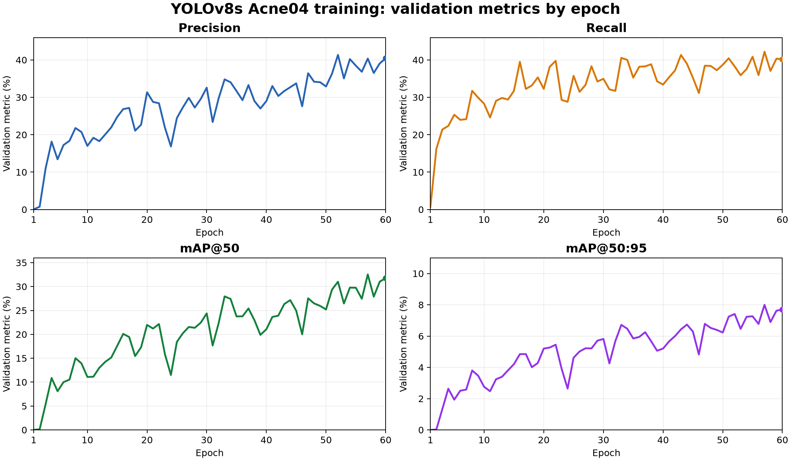
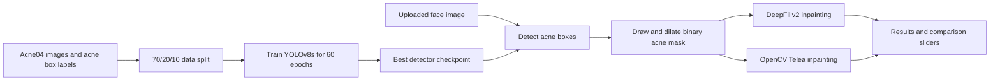
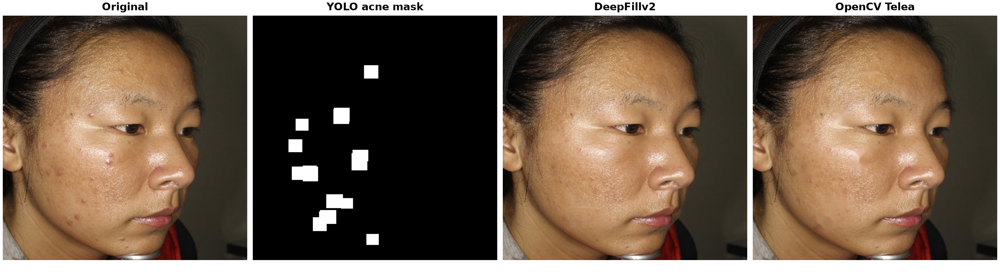

# Pimple Removal Tool

Upload a face photo to compare acne removal by DeepFillv2 and OpenCV Telea inpainting. A YOLOv8s detector trained on Acne04 finds the acne regions. Both methods use the same detected mask. The app shows each result and provides draggable sliders for original versus DeepFillv2 and OpenCV versus DeepFillv2.

## Run the demo

In PowerShell, from this repository:

```powershell
python -m venv .venv
.\.venv\Scripts\python.exe -m pip install -r requirements.txt
.\.venv\Scripts\python.exe app.py
```

Open the local address printed by Gradio , upload a face image, and click **Remove Pimples**. Press Ctrl+C to stop the app.

The trained detector is already included at `models/acne04_60_best.pt`, so uploading a new image does not retrain it. The first launch downloads DeepFillv2's inference code and pretrained weights and needs internet access. Later launches reuse those files. OpenCV Telea is a classical algorithm and needs no trained checkpoint. Processing may take longer on a CPU.

To use a different YOLO checkpoint, set `ACNE_YOLO_MODEL_PATH` before launching. To request a public Gradio share link, set `GRADIO_SHARE=1`.

## Training

The included YOLOv8s detector was trained for 60 epochs on the [Acne04 YOLOv8 dataset](https://www.kaggle.com/datasets/shreyash1110/acne04-yolov8). Its best validation mAP@50 was approximately 0.325 at epoch 57. The dataset and large training artifacts are excluded from GitHub; the best checkpoint and the training results CSV are committed.

### Training outlook

These curves plot the recorded validation metrics at every epoch. mAP@50 uses an intersection-over-union threshold of 0.50; mAP@50:95 averages thresholds from 0.50 through 0.95. The run does not record mAP at 0.95 alone.



| Epoch | Precision (%) | Recall (%) | mAP@50 (%) | mAP@50:95 (%) |
| ---: | ---: | ---: | ---: | ---: |
| 1 | 0.03 | 0.67 | 0.01 | 0.00 |
| 10 | 17.01 | 28.29 | 11.08 | 2.76 |
| 20 | 31.36 | 32.27 | 21.97 | 5.20 |
| 30 | 32.59 | 34.95 | 24.38 | 5.82 |
| 40 | 29.00 | 33.40 | 21.06 | 5.20 |
| 50 | 32.91 | 38.69 | 25.20 | 6.23 |
| **57 (best mAP@50)** | **40.37** | **42.20** | **32.53** | **8.00** |
| 60 | 40.43 | 40.19 | 31.77 | 7.70 |

The table shows milestones; [the full results CSV](docs/training_results.csv) contains all 60 epochs and the loss values. The included best checkpoint comes from epoch 57, which has the highest recorded validation mAP@50.

### Reproduce training

To reproduce the run, download that dataset and arrange it as:

```text
data/acne04-yolov8/
  Images/*.jpg
  labels/content/labels/*.txt
```

Then run:

```powershell
.\.venv\Scripts\python.exe train_acne04.py --epochs 60 --batch 16
```

The script creates a 70/20/10 train/validation/test split and saves outputs in `runs/yolov8s_acne_augmented_60/`. A smaller GPU may need `--batch 4`. To continue an interrupted run, use `--resume`. After retraining, copy its `weights/best.pt` to `models/acne04_60_best.pt` to use it in the app.

The comparison sliders show visual differences. Acne04 provides lesion boxes rather than paired clean target images, so these outputs cannot establish a numeric skin restoration accuracy score.

## Project Flow



The detector locates possible pimples in an uploaded image. The app fills each predicted box in a binary mask and dilates the mask so the inpainting methods cover the lesion edges. DeepFillv2 and OpenCV Telea receive the same image and mask, then produce separate 512 × 512 results. The Gradio interface shows both outputs and lets you drag across the original/DeepFillv2 and OpenCV/DeepFillv2 comparisons.

## Project Outcome

The example below is an actual inference on `levle1_203.jpg` from the held-out Acne04 test split. It uses confidence 0.10, a 9-pixel dilation kernel, and three dilation iterations. The white areas in the mask are the regions passed to both inpainting methods.



This is a visual comparison of one image. Some lesions can remain, and an overly broad mask can alter unaffected skin. The detection metrics above measure acne boxes, not the quality of the restored skin.

## Source credit

DeepFillv2 inference code and weights come from [vrindaprabhu/deepfillv2_colab](https://github.com/vrindaprabhu/deepfillv2_colab). The OpenCV baseline, comparison interface, training script, and 60-epoch detector checkpoint are included in this repository.
